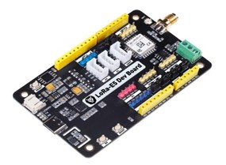
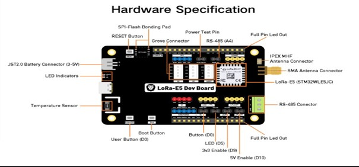
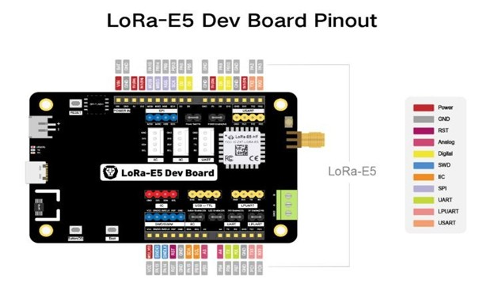

# Wio-E5 Development Kit

## 1. Overview

The Wio-E5 Development Kit is a LoRaWAN development platform based on the STM32WLE5JC microcontroller from STMicroelectronics. It combines an ARM Cortex-M4 core with an integrated LoRa radio transceiver, making it suitable for low-power and long-range IoT applications.

The board was used during this project to study LoRaWAN communication, configure the device through AT commands and connect it to The Things Network (TTN).

## 2. Main Features

| Feature | Description |
|---|---|
| Main MCU | STM32WLE5JC |
| CPU Core | ARM Cortex-M4 |
| CPU Frequency | Up to 48 MHz |
| Flash Memory | 256 KB |
| SRAM | 64 KB |
| Radio Frequency | 868 MHz / 915 MHz (depending on version) |
| Wireless Protocols | LoRaWAN and LoRa P2P |
| Interfaces | UART, I2C, SPI, ADC, GPIO |
| Programming | AT Commands and STM32 development |
| Debug Interface | SWD |
| Antenna Connector | SMA |
| USB Interface | USB Type-C |

## 3. Board Peripherals and Connectors

The development board provides several interfaces and peripherals that simplify prototyping and communication with external sensors and devices.

The main elements include:

- USB Type-C connector for power supply and USB communication.
- SMA antenna connector for LoRa wireless communication.
- UART interface for AT command communication.
- GPIO pins for digital input and output.
- ADC pins for analog sensor measurements.
- I2C and SPI interfaces for external peripherals.
- BOOT and RESET buttons for device configuration and restart.

## 4. Pinout Description

The pinout diagram identifies the available pins and their main functions. It is useful when connecting external sensors, modules and debugging tools.

### 4.1 GPIO

General Purpose Input/Output pins can be configured as digital inputs or outputs to interface with external electronic components.

### 4.2 ADC

Analog-to-Digital Converter pins allow the microcontroller to measure analog signals from sensors.

### 4.3 Communication Interfaces

The board supports several communication interfaces:

- UART / USART: serial communication with external devices and AT command interfaces.
- I2C: connection to sensors and peripheral modules using two communication lines.
- SPI: high-speed synchronous communication with compatible peripherals.

### 4.4 Debugging Interface

The SWD interface is used for programming and debugging the STM32 microcontroller with a compatible ST-LINK debugger.

### 4.5 Power and Control

The USB Type-C connector provides the board power supply. The BOOT and RESET buttons are used for boot configuration and restarting the microcontroller.

## 5. Role in the Project

In this project, the Wio-E5 Development Kit was used to explore LoRaWAN communication and understand the operation of the STM32WLE5JC-based platform.

The board was configured using AT commands and tested with a LoRaWAN network infrastructure based on The Things Network (TTN) and a Dragino LPS8N gateway.

Further implementation details and communication tests are documented in the Firmware, LoRaWAN and Gateway sections of this repository.
